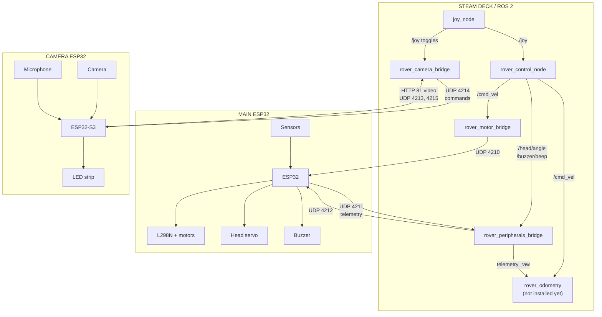

# Esp32-Autonomous-Rover-2026

A four-wheel mecanum rover with an ESP32 controller, driven from a Steam Deck over Wi-Fi with ROS 2. This repository has everything specific to the rover: the firmware, the ROS 2 packages, the start and stop shortcuts, the test tools, the Foxglove layouts and the 3D-printable parts.

The rover is the reference robot for the [Distributed ROS 2 Robotics Platform](https://github.com/SolarSpore/Distributed-Robotics-Platform-2026), which holds the general architecture, the node templates and a complete Steam Deck setup guide.

---

# Getting Started

The **[setup guide](Setup-Guide.md)** is a quick start. It walks you through:

* Installing Pixi and a ROS 2 workspace on the Steam Deck
* Linking and building the rover's ROS 2 packages
* Installing the desktop shortcuts and Foxglove
* Setting up the firmware project in PlatformIO with Visual Studio Code, and flashing the ESP32 over USB and over Wi-Fi

For a fuller explanation of the Pixi, ROS 2 and Foxglove setup, see the platform's [setup guide](https://github.com/SolarSpore/Distributed-Robotics-Platform-2026/blob/main/docs/install_guide.md).

---

# Repository Layout

```text
.
├── Setup-Guide.md               quick-start setup guide
├── firmware/                    PlatformIO project for the ESP32 (src/main.cpp, platformio.ini,
│                                include/config.example.h)
├── firmware-cam/                PlatformIO project for the camera board (src/main.cpp,
│                                platformio.ini, include/config.example.h)
├── rover_control/               teleoperation node, controller configuration, launch file
├── rover_motor_bridge/          /cmd_vel to the rover's drive protocol
├── rover_peripherals_bridge/    head, buzzer and telemetry
├── rover_camera_bridge/         camera board: video, microphone and LEDs
├── rover_odometry/              wheel odometry from the rear encoders (experimental)
├── rover_description/           robot description (placeholder, not built)
├── ros2_ws/                     Pixi workspace files: pixi.toml and pixi.lock
├── Shortcuts/                   start and stop scripts and the desktop icons
├── tools/                       wheel test scripts and a controller calibration wizard
├── foxglove/                    Foxglove dashboard layouts
├── STL/                         3D-printable parts
├── docs/                        rover documentation
└── CHANGELOG.md                 dated list of changes
```

---

# Components

* ESP32-WROOM-32 development board
* Two L298N motor drivers and four DC gear motors with mecanum wheels (X-pattern rollers)
* SG90 servo for the head
* HC-SR04 ultrasonic distance sensor
* Buzzer module
* 5-way TCRT5000L line sensor module
* Seeed XIAO ESP32-S3 Sense camera board (second ESP32) with a PDM microphone and a strip of seven addressable LEDs
* Two IR sensors, being moved to the camera board
* Two rear wheel encoders (planned, not fitted)

The pin assignments are constants at the top of `firmware/src/main.cpp`.

The camera board's are at the top of `firmware-cam/src/main.cpp`.

The printable parts are in the `STL/` folder.

---

# Current Reference Rover

The current reference robot is a four-wheel mecanum rover controlled by an ESP32.



This diagram represents the **current implementation**, not the future autonomous architecture.

The rover is important because it provides a complete working example of the platform's intended separation between:

1. ROS 2 control
2. Hardware bridges
3. Network communication
4. Microcontroller firmware
5. Physical hardware

---

# ROS 2 Control Nodes

## `rover_control_node`

This is the current rover's primary teleoperation/control node.

### Responsibilities

* Read `sensor_msgs/Joy`
* Implement arcade driving
* Implement tank driving
* Implement mecanum strafing
* Implement deadman behavior
* Implement turbo mode
* Toggle tank mode
* Implement proportional trigger drive (gas, brake, then reverse on the triggers), without a deadman
* Publish the active drive mode
* Generate head commands
* Generate buzzer commands

### ROS 2 interfaces

```text
Subscribe:
    /joy

Publish:
    /cmd_vel
    /head/angle
    /buzzer/beep
    /drive_mode
```

The current implementation is intentionally tied to the reference rover's controller layout and available control modes.

The **architecture is reusable**, but this particular node is not intended to be presented as a universal teleoperation package.

If another robot requires different controls, a different control node can implement the same general ROS 2 command concepts.

---

# `rover_motor_bridge`

The motor bridge is responsible for translating a ROS 2 velocity command into commands understood by the rover's motor hardware.

### Responsibilities

* Subscribe to `/cmd_vel`
* Apply mecanum kinematics
* Convert velocity to PWM values
* Apply minimum-PWM compensation
* Send drive packets to the ESP32
* Enforce a command timeout
* Send a stop packet during shutdown

### Current hardware protocol

```text
UDP 4210

FL,FR,RL,RR
```

The bridge is intentionally robot-specific.

A different robot could use a different bridge:

```text
Mecanum robot
    → mecanum motor bridge

Differential robot
    → differential motor bridge

Tracked robot
    → tracked motor bridge

Servo robot
    → servo actuator bridge
```

All of these can expose the appropriate ROS-facing interfaces while implementing completely different hardware underneath.

This is one of the main architectural boundaries of the project.

---

# `rover_peripherals_bridge`

The peripheral bridge handles non-drive hardware for the reference rover.

### Responsibilities

* Send head commands
* Send buzzer commands
* Receive telemetry
* Publish ultrasonic range data
* Publish raw telemetry
* Publish line sensor topics (`/line_sensor/raw`, `/line_sensor/detected`, `/line_sensor/position`)

### Current hardware protocol

```text
UDP 4212
    HEAD,<angle>
    BUZZ,<hz>,<ms>

UDP 4211
    telemetry
```

This demonstrates the platform's general **peripheral bridge** pattern.

The implementation is still rover-specific because it knows about this rover's:

* Head
* Buzzer
* Ultrasonic sensor
* Telemetry format

A future robot can implement a different peripheral bridge without changing the overall architecture.

---

# `rover_camera_bridge`

The camera bridge talks to the camera board, the rover's second ESP32.

### Responsibilities

* Read the camera board's video stream and publish it as `/camera/image/compressed`
* Switch the camera on and off
* Publish microphone level and audio, and switch the microphone mode
* Control the LED strip (colour, mode, brightness, single pixels)
* Publish the camera board's status line
* Toggle the camera, lights and microphone from the gamepad D-pad

### ROS 2 interfaces

```text
Publish:
    /camera/image/compressed
    /camera/enabled
    /microphone/level
    /microphone/audio
    /leds/state

Services:
    /camera/enable
    /microphone/enable
```

### Current hardware protocol

```text
HTTP 81   video stream
UDP 4213  status from the camera board
UDP 4214  commands: CAM, MIC, LED
UDP 4215  microphone audio
```

The platform repository has a generic [camera template](https://github.com/SolarSpore/Distributed-Robotics-Platform-2026/tree/main/Node-templates/ros2/camera_template) derived from this node.

---

# `rover_odometry` (experimental)

### Responsibilities

* Read wheel counts from `rover/telemetry_raw`
* Use `/cmd_vel` to resolve direction and strafing
* Publish `/odom`, `/odometry/rear_wheel_speeds` and the `odom` to `base_link` transform

It is written and tested against simulated counts only. It is not installed on the Deck and the rear wheel encoders are not fitted, so it does nothing until the wheel size, counts per turn and wheelbase are set. See "Encoders and Odometry" below.

---

# Reference Rover Hardware

## Drive

The reference robot uses four-wheel mecanum drive with an X-pattern roller arrangement.

```text
FL ───────── FR
│             │
│   ROBOT     │
│             │
RL ───────── RR
```

### Mecanum kinematics

```text
fl = linear.x - linear.y - angular.z * wheel_separation / 2
fr = linear.x + linear.y + angular.z * wheel_separation / 2
rl = linear.x + linear.y - angular.z * wheel_separation / 2
rr = linear.x - linear.y + angular.z * wheel_separation / 2
```

These equations are part of the **reference rover's mecanum implementation**, not a requirement for every robot using the platform.

---

# Reference UDP Interfaces

The following network protocol belongs specifically to the current ESP32 rover.

```text
4210  Deck → Rover
      FL,FR,RL,RR

4211  Rover → Network
      Telemetry

4212  Deck → Rover
      HEAD,<angle>
      BUZZ,<hz>,<ms>
      RELEASE

4213  Camera board → Network
      Status line

4214  Deck → Camera board
      CAM,... | MIC,... | LED,...

4215  Camera board → Deck
      Microphone audio (only while the microphone streams)

HTTP 81  Camera board → Deck
      Video stream

(With the rear wheel encoders fitted, the 4211 telemetry also carries wheel counts.)
```

These ports and packet formats are **implementation details**, not platform-wide requirements.

A future robot can use a different microcontroller, transport, protocol, or hardware architecture while exposing the appropriate ROS 2 interfaces.

---

# Camera Board

The second ESP32 is a Seeed XIAO ESP32-S3 Sense. It carries the camera, a PDM microphone and a strip of seven addressable LEDs, and two IR sensors are planned for it. Its firmware is in `firmware-cam/` and builds as its own PlatformIO project; its Wi-Fi and OTA settings live in a `config.h` that is never committed (copy `config.example.h` and fill it in).

The board serves a web page with the video and the light controls on port 80, and the video stream on port 81. The microphone is off until it is switched on. Give the board a fixed address with a reservation in your router.

Still to be checked: the board runs hot, the 5 V rail has not been measured against its peak current, and the video smoothness while driving is untested.

---

# Controls

| Control | Action |
|---|---|
| L1 | Deadman in arcade, tank and strafe modes (not needed in trigger drive) |
| R1 | Boost |
| Left stick | Arcade forward, back and steering (in trigger drive, only the steering) |
| A, held 3 s | Tank mode on or off |
| X + D-pad left/right | Strafe |
| L1 + both triggers, held 3 s | Proportional trigger drive on or off: right trigger gas, left trigger brake then reverse |
| B | Beep |
| Right stick X | Head swivel |
| D-pad up, held 1 to 3 s | Lights on or off |
| D-pad up, held 3 s | Camera on or off |
| D-pad down, held 3 s | Microphone off or level |

The D-pad toggles and trigger drive have not yet been confirmed on the real gamepad.

---

# Encoders and Odometry

**Status: In progress**

The main firmware can count two rear wheel encoders (one channel each, on GPIO 17 and 4). This is off by default (`ENCODERS_FITTED`) because the encoders are not fitted. When they are, the telemetry line carries the counts and `rover_odometry` turns them into `/odom`.

Two rear wheels give forward speed but cannot tell turning from strafing, so the node uses the drive command to decide. Slip is not seen and the heading will drift. Front encoders or an IMU would remove that limit.
