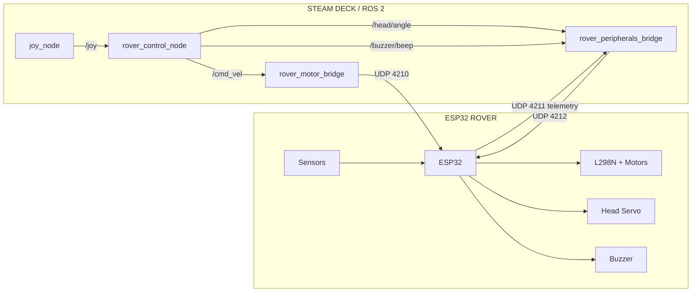

# Esp32-Autonomous-Rover-2026

A four-wheel mecanum rover with an ESP32 controller, driven from a Steam Deck over Wi-Fi with ROS 2. This repository has everything specific to the rover: the firmware, the ROS 2 packages, the start and stop shortcuts, the test tools, the Foxglove layouts and the 3D-printable parts.

The rover is the reference robot for the [Distributed ROS 2 Robotics Platform](https://github.com/SolarSpore/Distributed-Robotics-Platform-2026), which holds the general architecture, the node templates and a complete Steam Deck setup guide.

---

# Getting Started

The **[setup guide](Setup-Guide.md)** is a quick start. It walks you through:

* Installing Pixi and a ROS 2 workspace on the Steam Deck
* Linking and building the rover's ROS 2 packages
* Installing the desktop shortcuts and Foxglove
* Setting up the firmware project in PlatformIO with Visual Studio Code, and flashing the ESP32 over USB and over Wi-Fi

For a fuller explanation of the Pixi, ROS 2 and Foxglove setup, see the platform's [setup guide](https://github.com/SolarSpore/Distributed-Robotics-Platform-2026/blob/main/docs/install_guide.md).

---

# Repository Layout

```text
.
├── Setup-Guide.md               quick-start setup guide
├── firmware/                    PlatformIO project for the ESP32 (src/main.cpp, platformio.ini,
│                                include/config.example.h)
├── rover_control/               teleoperation node, controller configuration, launch file
├── rover_motor_bridge/          /cmd_vel to the rover's drive protocol
├── rover_peripherals_bridge/    head, buzzer and telemetry
├── rover_description/           robot description (placeholder, not built)
├── ros2_ws/                     Pixi workspace files: pixi.toml and pixi.lock
├── Shortcuts/                   start and stop scripts and the desktop icons
├── tools/                       wheel test scripts and a controller calibration wizard
├── foxglove/                    Foxglove dashboard layouts
├── STL/                         3D-printable parts
├── docs/                        rover documentation
└── CHANGELOG.md                 dated list of changes
```

---

# Components

* ESP32-WROOM-32 development board
* Two L298N motor drivers and four DC gear motors with mecanum wheels (X-pattern rollers)
* SG90 servo for the head
* HC-SR04 ultrasonic distance sensor
* Buzzer module
* 5-way TCRT5000L line sensor module and two IR sensors

The pin assignments are constants at the top of `firmware/src/main.cpp`.

The printable parts are in the `STL/` folder.

---

# Current Reference Rover

The current reference robot is a four-wheel mecanum rover controlled by an ESP32.



This diagram represents the **current implementation**, not the future autonomous architecture.

The rover is important because it provides a complete working example of the platform's intended separation between:

1. ROS 2 control
2. Hardware bridges
3. Network communication
4. Microcontroller firmware
5. Physical hardware

---

# ROS 2 Control Nodes

## `rover_control_node`

This is the current rover's primary teleoperation/control node.

### Responsibilities

* Read `sensor_msgs/Joy`
* Implement arcade driving
* Implement tank driving
* Implement mecanum strafing
* Implement deadman behavior
* Implement turbo mode
* Toggle tank mode
* Generate head commands
* Generate buzzer commands

### ROS 2 interfaces

```text
Subscribe:
    /joy

Publish:
    /cmd_vel
    /head/angle
    /buzzer/beep
```

The current implementation is intentionally tied to the reference rover's controller layout and available control modes.

The **architecture is reusable**, but this particular node is not intended to be presented as a universal teleoperation package.

If another robot requires different controls, a different control node can implement the same general ROS 2 command concepts.

---

# `rover_motor_bridge`

The motor bridge is responsible for translating a ROS 2 velocity command into commands understood by the rover's motor hardware.

### Responsibilities

* Subscribe to `/cmd_vel`
* Apply mecanum kinematics
* Convert velocity to PWM values
* Apply minimum-PWM compensation
* Send drive packets to the ESP32
* Enforce a command timeout
* Send a stop packet during shutdown

### Current hardware protocol

```text
UDP 4210

FL,FR,RL,RR
```

The bridge is intentionally robot-specific.

A different robot could use a different bridge:

```text
Mecanum robot
    → mecanum motor bridge

Differential robot
    → differential motor bridge

Tracked robot
    → tracked motor bridge

Servo robot
    → servo actuator bridge
```

All of these can expose the appropriate ROS-facing interfaces while implementing completely different hardware underneath.

This is one of the main architectural boundaries of the project.

---

# `rover_peripherals_bridge`

The peripheral bridge handles non-drive hardware for the reference rover.

### Responsibilities

* Send head commands
* Send buzzer commands
* Receive telemetry
* Publish ultrasonic range data
* Publish raw telemetry

### Current hardware protocol

```text
UDP 4212
    HEAD,<angle>
    BUZZ,<hz>,<ms>

UDP 4211
    telemetry
```

This demonstrates the platform's general **peripheral bridge** pattern.

The implementation is still rover-specific because it knows about this rover's:

* Head
* Buzzer
* Ultrasonic sensor
* Telemetry format

A future robot can implement a different peripheral bridge without changing the overall architecture.

---

# Reference Rover Hardware

## Drive

The reference robot uses four-wheel mecanum drive with an X-pattern roller arrangement.

```text
FL ───────── FR
│             │
│   ROBOT     │
│             │
RL ───────── RR
```

### Mecanum kinematics

```text
fl = linear.x - linear.y - angular.z * wheel_separation / 2
fr = linear.x + linear.y + angular.z * wheel_separation / 2
rl = linear.x + linear.y - angular.z * wheel_separation / 2
rr = linear.x - linear.y + angular.z * wheel_separation / 2
```

These equations are part of the **reference rover's mecanum implementation**, not a requirement for every robot using the platform.

---

# Reference UDP Interfaces

The following network protocol belongs specifically to the current ESP32 rover.

```text
4210  Deck → Rover
      FL,FR,RL,RR

4211  Rover → Network
      Telemetry

4212  Deck → Rover
      HEAD,<angle>
      BUZZ,<hz>,<ms>
      RELEASE
```

These ports and packet formats are **implementation details**, not platform-wide requirements.

A future robot can use a different microcontroller, transport, protocol, or hardware architecture while exposing the appropriate ROS 2 interfaces.
