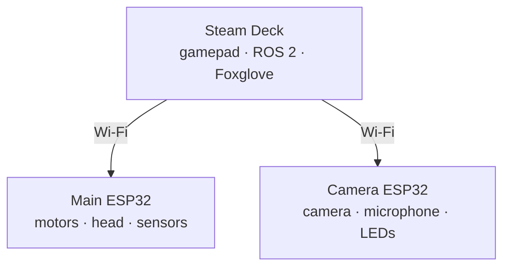
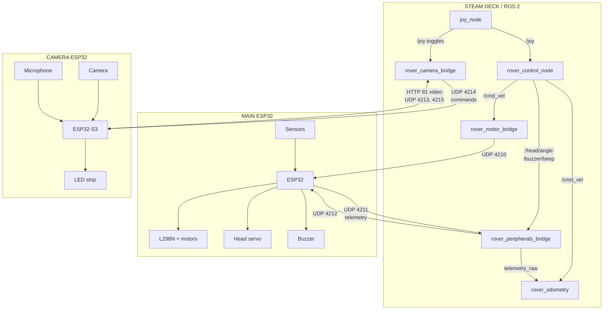

# Esp32-Autonomous-Rover-2026

A four-wheel mecanum rover that you drive with a Steam Deck. The Deck is the whole operator station: its gamepad is the controller, its processor runs the ROS 2 software, and its screen runs Foxglove, so you can look through the rover's camera and watch its sensors while you drive.

The rover itself carries only small ESP32 boards. One drives the motors, the head servo and the sensors. A second carries the camera, a microphone and an LED strip. Both talk to the Steam Deck over Wi-Fi, and everything else happens on the Deck.

This repository has everything specific to the rover: the firmware for both boards, the ROS 2 packages, the start and stop shortcuts, the test tools, the Foxglove layouts and the 3D-printable parts. The rover is the reference robot for the [Distributed ROS 2 Robotics Platform](https://github.com/SolarSpore/Distributed-Robotics-Platform-2026), which holds the general architecture, the node templates and a complete Steam Deck setup guide.



---

# Getting Started

The **[setup guide](Setup-Guide.md)** is a quick start. It walks you through:

* Installing Pixi and a ROS 2 workspace on the Steam Deck
* Linking and building the rover's ROS 2 packages
* Installing the desktop shortcuts and Foxglove
* Setting up the firmware projects in PlatformIO with Visual Studio Code, and flashing the ESP32 boards over USB and over Wi-Fi

For a fuller explanation of the Pixi, ROS 2 and Foxglove setup, see the platform's [setup guide](https://github.com/SolarSpore/Distributed-Robotics-Platform-2026/blob/main/docs/install_guide.md).

---

# Driving with the Steam Deck

The Steam Deck's own controls drive the rover, so there is nothing else to carry or connect. The left stick drives and steers, the right stick swings the head, and a few buttons switch modes.

| Control | Action |
|---|---|
| L1 | Deadman: hold it to drive in arcade, tank and strafe modes |
| R1 | Boost |
| Left stick | Forward, back and steering |
| A, held 3 s | Switch tank mode on or off (the two sticks drive the two sides) |
| X + D-pad left or right | Strafe |
| L1 + both triggers, held 3 s | Switch proportional trigger drive on or off: right trigger for gas, left trigger for brake and then reverse |
| B | Beep |
| Right stick X | Swing the head |
| D-pad up, held 1 to 3 s | Lights on or off |
| D-pad up, held 3 s | Camera on or off |
| D-pad down, held 3 s | Microphone off or level |

Every button and axis number lives in `rover_control/config/steam_deck_controls.yaml`, together with the speed scales. The D-pad toggles assume the Steam Deck's virtual Xbox gamepad, so if your numbers differ, `tools/joy_mapper.py` shows which ones your pad uses.

---

# Seeing the Rover with Foxglove

Foxglove Studio runs on the Steam Deck and connects to the ROS 2 graph, so the same screen that you drive from shows what the rover sees and measures.

* **Camera.** An Image panel on `/camera/image/compressed` shows the live video from the camera board. The `/camera/enable` service and the D-pad switch the camera on and off.
* **Distance.** A plot of `/ultrasonic/range` shows the ultrasonic distance as you approach an obstacle.
* **Line sensor.** `/line_sensor/raw`, `/line_sensor/detected` and `/line_sensor/position` show what the five-way line module sees.
* **Microphone.** `/microphone/level` shows how loud it is around the rover, and `/microphone/audio` carries the audio itself.
* **Driving.** A plot of `/cmd_vel` shows exactly what the controller is asking for, and `/drive_mode` shows the active mode.
* **Position.** `/odom` and the `odom` to `base_link` transform can be shown in the 3D panel.
* **Raw telemetry.** `/rover/telemetry_raw` shows the text line the main board broadcasts.

Dashboard layouts are kept in `foxglove/`, and its README explains how to import one.

---

# Repository Layout

```text
.
├── Setup-Guide.md               quick-start setup guide
├── firmware/                    PlatformIO project for the main ESP32 (src/main.cpp,
│                                platformio.ini, include/config.example.h)
├── firmware-cam/                PlatformIO project for the camera board (src/main.cpp,
│                                platformio.ini, include/config.example.h)
├── rover_control/               teleoperation node, controller configuration, launch file
├── rover_motor_bridge/          /cmd_vel to the rover's drive protocol
├── rover_peripherals_bridge/    head, buzzer, ultrasonic range and line sensor
├── rover_camera_bridge/         camera board: video, microphone and LEDs
├── rover_odometry/              wheel odometry from the rear encoders
├── rover_description/           robot description files
├── ros2_ws/                     Pixi workspace files: pixi.toml and pixi.lock
├── Shortcuts/                   start and stop scripts and the desktop icons
├── tools/                       wheel test scripts and a controller calibration wizard
├── foxglove/                    Foxglove dashboard layouts
├── STL/                         3D-printable parts
├── docs/                        rover documentation
└── CHANGELOG.md                 dated list of changes
```

---

# Components

* ESP32-WROOM-32 development board (main controller)
* Two L298N motor drivers and four DC gear motors with mecanum wheels (X-pattern rollers)
* SG90 servo for the head
* HC-SR04 ultrasonic distance sensor
* Buzzer module
* 5-way TCRT5000L line sensor module
* Seeed XIAO ESP32-S3 Sense camera board, with its camera, a PDM microphone and a strip of seven addressable LEDs
* Two IR sensors, connected to the camera board
* Two rear wheel encoders, one channel each, for odometry

The pin assignments are constants at the top of `firmware/src/main.cpp` and `firmware-cam/src/main.cpp`. The printable parts are in the `STL/` folder.

---

# How It Fits Together

Each part of the rover has its own ROS 2 node on the Steam Deck. The control node turns the gamepad into velocity commands, and a bridge for each ESP32 turns those commands into the messages that board understands.



Foxglove reads all of these topics through `foxglove_bridge`, which is how the camera and sensor data reach the dashboard.

---

# ROS 2 Nodes

## `rover_control_node`

The rover's teleoperation node. It reads the gamepad and decides what the rover should do.

* Reads `sensor_msgs/Joy`
* Drives in arcade, tank, strafe and proportional trigger modes
* Applies the deadman and boost
* Generates head and buzzer commands
* Publishes the active mode on `/drive_mode`

```text
Subscribe:
    /joy

Publish:
    /cmd_vel
    /head/angle
    /buzzer/beep
    /drive_mode
```

The node is written around the Steam Deck's controller layout. A robot with different controls can use a different control node that publishes the same ROS 2 commands.

## `rover_motor_bridge`

Translates `/cmd_vel` into drive commands for the main ESP32.

* Applies mecanum kinematics
* Converts velocity to PWM values, with a minimum-PWM compensation
* Sends drive packets to the ESP32 and stops the rover if commands stop arriving
* Sends a stop packet when it shuts down

```text
UDP 4210

FL,FR,RL,RR
```

## `rover_peripherals_bridge`

Handles the head, the buzzer and the main board's sensors.

* Sends head and buzzer commands
* Receives telemetry from the main ESP32
* Publishes ultrasonic range data on `/ultrasonic/range`
* Publishes the line sensor on `/line_sensor/raw`, `/line_sensor/detected` and `/line_sensor/position`
* Publishes the raw telemetry line on `/rover/telemetry_raw`

```text
UDP 4212
    HEAD,<angle>
    BUZZ,<hz>,<ms>

UDP 4211
    telemetry
```

## `rover_camera_bridge`

Talks to the camera board.

* Reads the video stream and publishes it as `/camera/image/compressed`
* Switches the camera on and off
* Publishes microphone level and audio, and switches the microphone mode
* Controls the LED strip: colour, mode, brightness and single pixels
* Publishes the camera board's status line
* Toggles the camera, lights and microphone from the gamepad D-pad

```text
Publish:
    /camera/image/compressed
    /camera/enabled
    /microphone/level
    /microphone/audio
    /leds/state

Services:
    /camera/enable
    /microphone/enable
```

The platform repository has a generic [camera template](https://github.com/SolarSpore/Distributed-Robotics-Platform-2026/tree/main/Node-templates/ros2/camera_template) derived from this node.

## `rover_odometry`

Turns the rear wheel encoder counts into an estimate of where the rover is.

* Reads the wheel counts from `/rover/telemetry_raw`
* Uses `/cmd_vel` to tell forward driving from turning and strafing
* Publishes `/odom`, `/odometry/rear_wheel_speeds` and the `odom` to `base_link` transform

---

# Camera Board

The camera board is a Seeed XIAO ESP32-S3 Sense. It carries the camera, a PDM microphone and a strip of seven addressable LEDs, and the two IR sensors connect to it as well. Its firmware is in `firmware-cam/` and builds as its own PlatformIO project. Its Wi-Fi and OTA settings live in a `config.h` that is never committed: copy `config.example.h` and fill it in.

The board serves a web page with the video and the light controls on port 80, and the video stream on port 81, so you can check it from any browser before ROS is involved. The microphone is off until it is switched on. Give the board a fixed address with a reservation in your router. It runs warm in use, so leave it some airflow.

---

# Wheel Odometry

The rover tracks its own position from two rear wheel encoders, one channel each, on GPIO 17 (rear left) and GPIO 4 (rear right). The main board counts the pulses and adds the counts to its telemetry line, and `rover_odometry` turns them into `/odom` and the `odom` to `base_link` transform. Foxglove's 3D panel draws the result as the rover drives.

Counting is controlled by `ENCODERS_FITTED` in `firmware/src/main.cpp`. To set it up on your own rover:

1. Connect the encoders to GPIO 17 and 4 and power them from 3.3 V.
2. Make sure `ENCODERS_FITTED` is `true`, and flash the main board.
3. Set the wheel radius, the counts per wheel turn and the wheelbase in `rover_odometry/config/odometry.yaml`.
4. Calibrate on the floor: drive one metre and scale the wheel radius by real distance over reported distance, then turn on the spot and adjust the wheelbase.

Two rear wheels give an exact forward speed but cannot tell turning from strafing, so the node uses the drive command to decide. Wheel slip is not measured, so the heading drifts over distance.

---

# Reference Rover Hardware

## Drive

The rover uses four-wheel mecanum drive with an X-pattern roller arrangement.

```text
FL ───────── FR
│             │
│   ROBOT     │
│             │
RL ───────── RR
```

### Mecanum kinematics

```text
fl = linear.x - linear.y - angular.z * wheel_separation / 2
fr = linear.x + linear.y + angular.z * wheel_separation / 2
rl = linear.x + linear.y - angular.z * wheel_separation / 2
rr = linear.x - linear.y + angular.z * wheel_separation / 2
```

These equations are part of the rover's mecanum implementation, not a requirement for every robot using the platform.

---

# UDP Interfaces

The following network protocol belongs to the rover's two ESP32 boards.

```text
4210  Deck → Main board
      FL,FR,RL,RR

4211  Main board → Network
      Telemetry (with the wheel encoders connected, also the wheel counts)

4212  Deck → Main board
      HEAD,<angle>
      BUZZ,<hz>,<ms>
      RELEASE

4213  Camera board → Network
      Status line

4214  Deck → Camera board
      CAM,... | MIC,... | LED,...

4215  Camera board → Deck
      Microphone audio (only while the microphone streams)

HTTP 80  Camera board → Browser
      Page with the video and the light controls

HTTP 81  Camera board → Deck
      Video stream
```

These ports and packet formats are implementation details of this rover. A different robot can use another microcontroller, transport or protocol while exposing the same ROS 2 interfaces.
